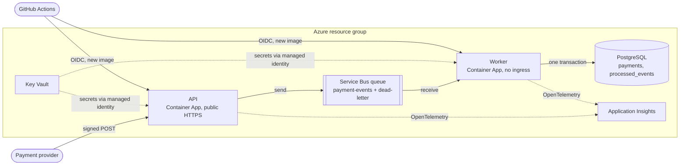
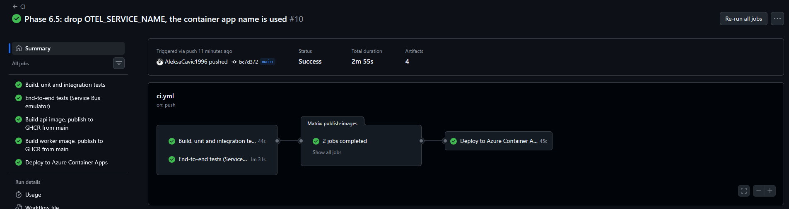
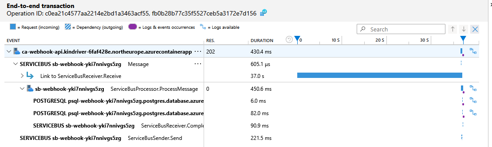
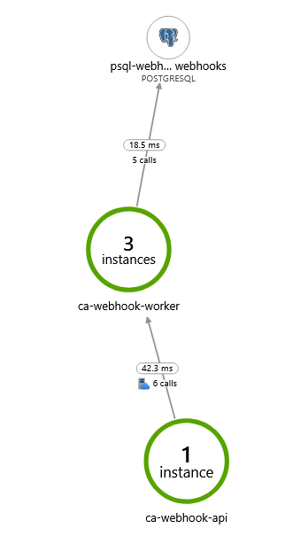

# Azure Webhook Processor

[](https://github.com/AleksaCavic1996/azure-webhook-processor/actions/workflows/ci.yml)

An idempotent payment webhook processor built with .NET and Azure Service Bus.
The same event delivered several times changes state only once.

It runs on Azure Container Apps with Azure Service Bus, PostgreSQL Flexible Server and Key Vault. The infrastructure is defined in Bicep, and every push to `main` is tested and deployed by GitHub Actions through OIDC, with no stored credentials.

## Architecture



## Design

1. `POST /webhooks/payments` validates an HMAC signature, enqueues the event and returns `202 Accepted`. It returns `401` for a bad signature, `400` for an invalid payload and `503` if the queue is unavailable.
2. A worker consumes the queue and, in one transaction, records the event and updates the payment. The message is completed only after the commit.
3. Delivery is at-least-once, and the effect is applied once per `eventId`. `INSERT ... ON CONFLICT DO NOTHING` on `processed_events` detects duplicates, including concurrent ones.
4. A failed delivery is retried after 2, 4, 8 and 16 seconds, and goes to the dead-letter queue after the fifth attempt. A message that can never succeed goes there immediately.

Known limitation: the retries span about 30 seconds of pauses, so a longer database outage moves messages to the dead-letter queue. They are not lost, and resending them is safe because processing is idempotent. Resending is a manual step for now.

## Repository layout

| Path | Purpose |
| --- | --- |
| `src/WebhookProcessor.Api` | Webhook endpoint |
| `src/WebhookProcessor.Worker` | Queue consumer |
| `src/WebhookProcessor.Core` | Shared contracts |
| `tests/WebhookProcessor.Tests` | Tests |
| `infra/` | Infrastructure as code |
| `.github/workflows/` | CI/CD pipelines |
| `scripts/` | Local helper scripts |

## Run locally

Requires the .NET 10 SDK and Docker Desktop.

1. Copy `.env.example` to `.env`, set both passwords, and set `ACCEPT_EULA=Y` if you accept the license terms linked in that file.
2. Start the infrastructure:

   ```
   docker compose up -d
   ```

3. Check that the Service Bus emulator is ready:

   ```
   curl http://localhost:5300/health
   ```

4. Store the local secrets outside the repository, using your `POSTGRES_PASSWORD` and any long random signing secret:

   ```
   dotnet user-secrets set "ConnectionStrings:Postgres" "Host=localhost;Port=5432;Database=webhooks;Username=webhooks;Password=<password>" --project src/WebhookProcessor.Worker
   dotnet user-secrets set "Webhook:SigningSecret" "<secret>" --project src/WebhookProcessor.Api
   ```

5. Start the API and the worker, each in its own terminal. In the Development environment, the worker applies database migrations on startup.

   ```
   dotnet run --project src/WebhookProcessor.Api --launch-profile http
   dotnet run --project src/WebhookProcessor.Worker
   ```

6. Send the same signed event three times, then check that the amount was added only once:

   ```powershell
   1..3 | ForEach-Object { ./scripts/send-test-event.ps1 -EventId evt-1 -PaymentId pay-1 -Amount 1500 }
   docker compose exec postgres psql -U webhooks -d webhooks -c "select * from payments"
   ```

| Service | Address |
| --- | --- |
| API | `http://localhost:5271` |
| Worker (health only) | `http://localhost:5272` |
| PostgreSQL | `localhost:5432` |
| Service Bus emulator (AMQP) | `localhost:5672` |
| Service Bus emulator (management, health) | `localhost:5300` |

Both the API and the worker expose `/health/live` (the process is running) and `/health/ready` (its dependencies are available).

The emulator does not persist messages or entities across container restarts. The queue is recreated from `servicebus-config.json` on startup.

## Tests

Requires Docker. The unit and API tests need no container themselves, but the test assembly starts one PostgreSQL container for the whole run, so without Docker every test fails at startup.

```
dotnet test
```

| Group | What it proves | Needs |
| --- | --- | --- |
| `Unit` | HMAC signature (checked against a value computed with openssl), replay window, payload validation | nothing |
| `Api` | Status codes 202, 400, 401 and 503, and that the exact signed bytes reach the queue. The broker is replaced by a recording fake. | nothing |
| `Integration` | Idempotency against real PostgreSQL: the same event three times, ten parallel deliveries of one event, redelivery after a crash before the message is completed, order-independent status, rollback on a currency mismatch | Docker (Testcontainers) |
| `EndToEnd` | Signed HTTP request to database row through the Service Bus emulator, ten parallel posts, a poison message dead-lettered without blocking the queue | Docker, about 1 minute to start the emulator |

Skip the slow end-to-end group:

```
dotnet test -- --filter-not-trait "Category=EndToEnd"
```

The end-to-end tests start the Service Bus emulator, which means accepting its license terms (linked in `.env.example`).

## Containers

Both services have a multi-stage Dockerfile. They build with the .NET SDK version from `global.json` and run on the chiseled ASP.NET image, which has no shell or package manager and runs as a non-root user.

Run the whole system in containers (set `WEBHOOK_SIGNING_SECRET` in `.env` first):

```powershell
docker compose --profile app up -d --build
./scripts/send-test-event.ps1 -EventId evt-1 -PaymentId pay-1 -FromEnvFile
```

The API container listens on `http://localhost:8080` and the worker's health endpoints on `http://localhost:8081`.

## CI

`.github/workflows/ci.yml` runs on every push to `main` and every pull request:

1. Release build with warnings treated as errors, then the unit, API and integration tests.
2. In parallel, the end-to-end tests against the Service Bus emulator.
3. After both pass, the `api` and `worker` images are built. On `main` they are pushed to GitHub Container Registry as `ghcr.io/aleksacavic1996/webhook-processor-api` and `-worker`, tagged with the commit SHA and `latest`. The push uses the workflow token, so no credentials are stored.
4. On `main`, the `deploy` job then rolls those images out to Azure (see [Deployment](#deployment)).

## Azure

Everything lives in one resource group and is created from `infra/main.bicep`.

| Resource | Role | Notes |
| --- | --- | --- |
| Container Apps (consumption) | Runs the API and the worker | Both scale to zero. The API starts on an HTTP request, the worker when messages are waiting (KEDA Service Bus rule). |
| Service Bus, Basic tier | Queue between the API and the worker | One queue with the same settings as the local emulator. Basic is enough: no topics, sessions or broker-side duplicate detection are used. |
| PostgreSQL Flexible Server, B1ms | Payments and the processed-event log | Same major version as local. Reachable only from inside Azure. |
| Key Vault | Connection strings and the signing secret | RBAC authorization, one role assignment per secret. |
| Managed identities | Access to Key Vault and deployment | One per application, one for the pipeline. |
| Application Insights + Log Analytics | Traces, metrics and logs | Fed by OpenTelemetry. |

### Security

- **No secrets in the repository, the images or the pipeline.** The database password and the signing secret are generated by `infra/deploy.ps1` on the first run, stored in Key Vault and read back from there on later runs.
- **Each application reads only its own secrets.** The API identity can read the send-only Service Bus key and the signing secret. It cannot read the database connection string.
- **Service Bus keys are split by role.** The API key can only send, the worker key can only listen. A third key with the `Manage` right is used by the autoscaler alone, to read the queue length.
- **The worker has no ingress.** Only the API is reachable from the internet.

### Deployment

Infrastructure and application are deployed separately, with different privileges.

**Infrastructure** is deployed by a person with rights on the subscription:

```powershell
az login
./infra/deploy.ps1            # add -WhatIf to preview
```

**Application** is deployed by the `deploy` job in CI on every push to `main`:

1. It signs in to Azure with OIDC. GitHub presents a short-lived token, and Azure accepts it only for this repository's `main` branch. There is no client secret to leak or rotate.
2. It updates both container apps to the image tagged with the commit SHA.
3. It waits for `/health/ready` on the new API revision and checks that both apps run that exact image.

The pipeline identity may change the two container apps and nothing else. It cannot reach the database, Service Bus, Key Vault or role assignments.



Send a signed test event to the deployed API:

```powershell
./scripts/send-test-event.ps1 -EventId evt-1 -PaymentId pay-1 -KeyVaultName <vault> -Url https://<api-host>/webhooks/payments
```

### Observability

Both services export traces, metrics and logs through OpenTelemetry to Application Insights. Export is on only where `APPLICATIONINSIGHTS_CONNECTION_STRING` is set, so local runs and tests send nothing.

The Service Bus client carries the trace context inside the message, so one event is one trace: the HTTP request, the send to the queue, the processing in the worker, each SQL command and the message completion. Log lines from both services carry the same trace id. Health probe requests are filtered out.

One event in Application Insights, from the HTTP request to the database:



The API answers `202` and sends the message, the worker processes it with two SQL commands (record the event, update the payment) and completes the message. The long bar is not processing time: it is the worker's receive call, which had been waiting on the empty queue for 37 seconds when this message arrived.

The application map built from the same telemetry:



### Cost

An idle system costs close to nothing: both apps scale to zero, Service Bus Basic is billed per operation, and the B1ms database is covered by the Azure free offer for 12 months. Deleting the resource group removes everything:

```
az group delete -n rg-webhook-processor
```

## Trade-offs

| Decision | Why | What it costs |
| --- | --- | --- |
| Idempotency in the database, not in the broker | Works on the cheapest Service Bus tier and is covered by tests against real PostgreSQL | One extra insert per event |
| Scale to zero | No cost while idle | The first request after idle waits a few seconds for a cold start. Webhook providers retry, so this is acceptable. |
| Connection strings in Key Vault | No application code depends on Azure identity libraries | They are still shared keys. Passwordless access with managed identity to Service Bus and PostgreSQL is the next step. |
| Database open to Azure-internal traffic | Container Apps on the consumption plan have no fixed outbound address | Any Azure tenant can reach the port, so TLS and the password are the protection. A private endpoint in a virtual network would close it, at extra cost. |
| Bicep | No state file and no extra tooling beyond the Azure CLI | Azure only |
| Pipeline deploys images only | A compromised pipeline cannot read secrets or delete infrastructure | Infrastructure changes are a manual step |
